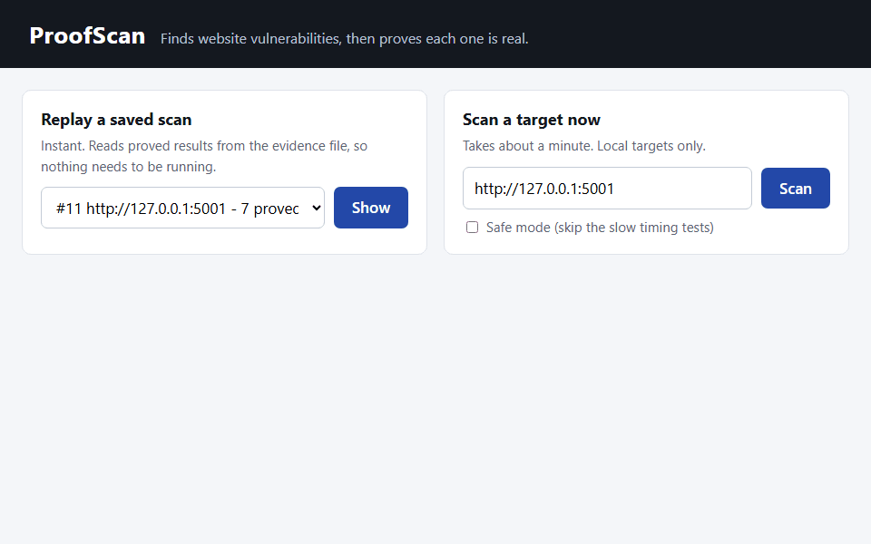
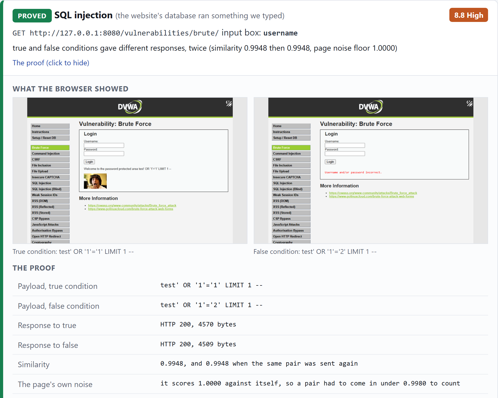
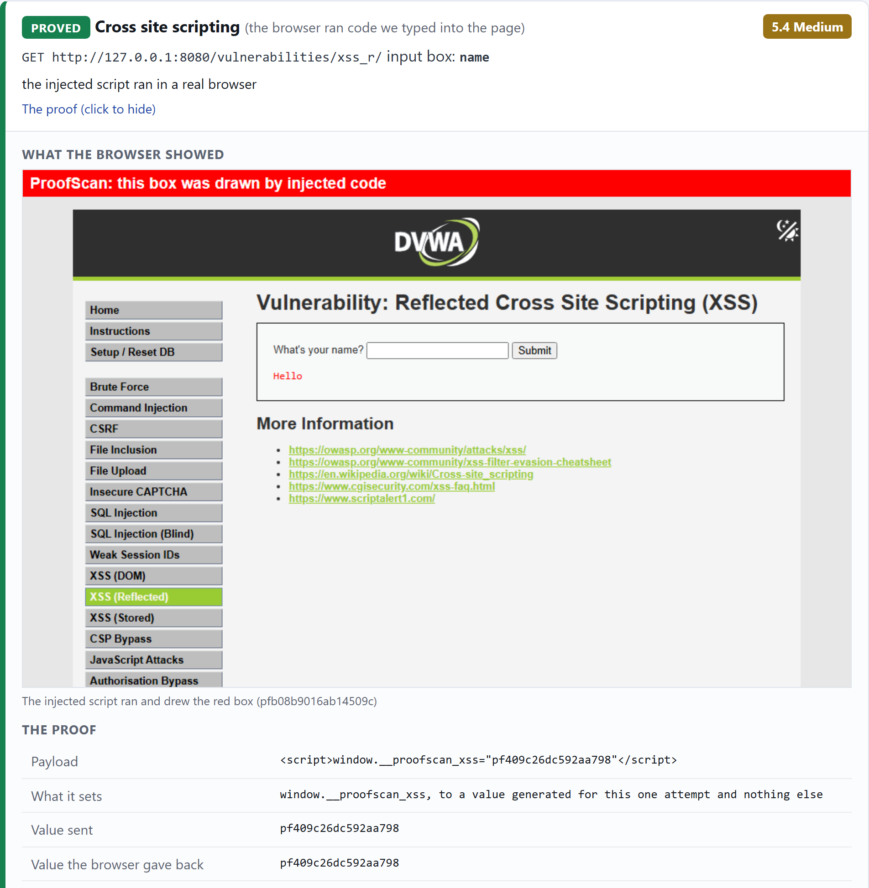
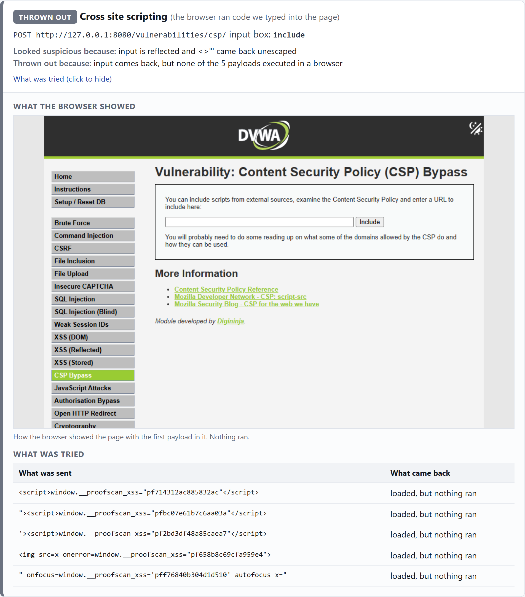
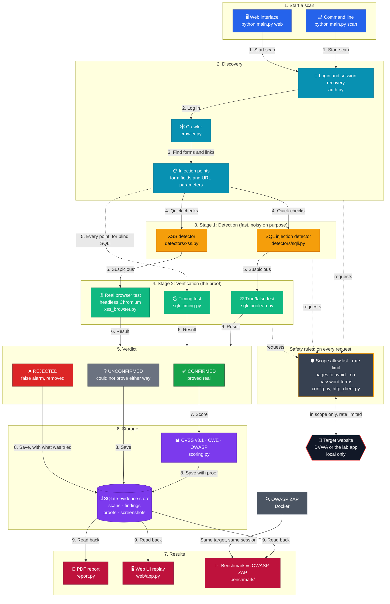

# ProofScan

Automated website security testing with self verification and report generation.

B.Tech major project, Group 105, School of Electronics Engineering, KIIT.

**Live demo: [proofscan.pages.dev](https://proofscan.pages.dev)** (replays real saved scans, cannot scan anything)



## The problem

Vulnerability scanners report a lot of things that are not real. Someone has to
check every alert by hand, which is the slow part of an assessment. In an
assessment I did on a practice lab, 39% of the scanner's findings had to be
rejected as unconfirmed.

ProofScan does that checking automatically. Each candidate finding gets an
active test that tries to prove it is real. Only what it can prove goes in the
report, along with the request and response that proves it.

## How the verification works

**SQL injection, true/false test.** Send a condition that is always true and one
that is always false. If the two responses come back different, the database
actually evaluated the input.

**SQL injection, timing test.** Send two inputs that both carry a delay, one
behind a true condition and one behind a false one, ten times each. One slow
reply proves nothing. It is confirmed only if the true side is slower every
single time.

**XSS.** Load the page in a headless browser and check whether the injected
script actually executed. Reflection on its own is not enough.

Every finding ends up as CONFIRMED, UNCONFIRMED (could not prove it safely), or
REJECTED (proved it is not there).

## What it looks like

Every finding comes with what the browser actually showed.

**Proved SQL injection.** The always-true input logs in, the always-false one
does not, so the database evaluated what we typed.



**Proved XSS.** After the proof, ProofScan sends one more script that draws the
red box. The picture is kept only if the browser hands back that script's own
random token.



**Thrown out.** OWASP ZAP reports this page as High risk XSS. The input does
come back unescaped, but the page's Content-Security-Policy stopped all five
payloads from running, so ProofScan threw it out.



## Results

Benchmarked against OWASP ZAP 2.17.0 on DVWA (security level low), scored on SQL
injection and XSS against a hand-written answer key:

| | Alerts | Correct | False alarms | Missed | Precision | Recall |
|---|---|---|---|---|---|---|
| ProofScan, verification off | 12 | 6 | 6 | 1 | 0.50 | 0.86 |
| ProofScan, verification on | 6 | 6 | 0 | 1 | **1.00** | 0.86 |
| OWASP ZAP | 7 | 6 | 1 | 1 | 0.86 | 0.86 |

Verification doubles precision with no loss of recall. The numbers were the same
across four ProofScan scans and two ZAP scans, six weeks apart. ZAP also reported
89 alerts in classes ProofScan does not look for, so this is a trade of coverage
for certainty, not a claim that ProofScan beats ZAP. Everyone missed DOM-based
XSS.

## Verify mode: checking ZAP's findings

ProofScan can also take another scanner's report and prove or reject each
finding. ZAP does the finding, including JavaScript-heavy pages and far more
kinds of problem. ProofScan does the proving. Each ZAP alert is rebuilt into a
full request by reading the form on that page, then sent through the same
validators a scan uses.

```
python main.py verify reports/zap-dvwa.json --rewrite http://dvwa=http://127.0.0.1:8080     --login-url http://127.0.0.1:8080/login.php --username admin --cookie security=low
```

On DVWA, ZAP's 7 SQL injection and XSS alerts:

| | Alerts | Correct | False alarms | Missed | Precision | Recall |
|---|---|---|---|---|---|---|
| ZAP alerts, as reported | 7 | 6 | 1 | 1 | 0.86 | 0.86 |
| ZAP alerts, verified by ProofScan | 6 | 6 | 0 | 1 | **1.00** | 0.86 |

The one removed is the CSP page above. It took 78 requests, against 368 for a
full ProofScan scan, because ZAP had already done the searching.

## Architecture overview

A scan runs top to bottom. Stage 1 is quick and flags anything suspicious.
Stage 2 tries to prove each one, and only what it proves is scored. Everything,
including what was thrown out and why, is saved, and the report, the web
interface and the ZAP benchmark all read from that saved copy. Every request to
the target goes through the safety rules on the right.



## Status

Phase 1, in progress.

- [x] scope / rules of engagement
- [x] http client with rate limit and timing
- [x] crawler
- [x] local test target
- [x] authentication, sessions and logged out recovery
- [x] detectors, sql injection and cross site scripting
- [x] validators, true/false, timing and headless browser
- [x] cvss v3.1 scoring, cwe and owasp mapping
- [x] evidence store
- [x] pdf report
- [x] benchmark against zap
- [x] web interface
- [x] screenshot evidence
- [x] repeat runs, results stable
- [x] verify mode for ZAP findings

## Setup

```
python -m venv venv
venv\Scripts\activate
pip install -r requirements.txt
playwright install chromium
```

## Running it

Start the test target in one terminal:

```
python labs/vulnerable_app/app.py
```

Crawl it from another:

```
python main.py crawl http://127.0.0.1:5001
```

Every scan is written to `evidence/proofscan.db`, and can be read back
without running the target again:

```
python main.py scans          # every scan in the file
python main.py show 1         # one scan, findings and proofs
python main.py diff 1 2       # what was fixed, what is new, what is still there
python main.py report 1       # one scan, as a pdf
```

Or open the web interface, which shows the same results on one page and can
replay any stored scan instantly, with nothing else running:

```
python main.py web            # http://127.0.0.1:8000
```

The pdf is written from the stored scan and never re-runs anything. It carries
the proof behind every confirmed finding, the CVSS score with a note saying
which metric was observed and which came from the class, and the candidates that
were thrown out along with what was tried against each.

Tests:

```
pytest -v
```

## The test target

`labs/vulnerable_app/` is a small flask app with deliberate bugs. It also has
safe endpoints that look vulnerable, which is the point:

- `/plain` reflects the input exactly but returns plain text, so nothing runs
- `/jitter` is randomly slow
- `/safe-product` and `/safe-search` are the fixed versions

It also has one that works the other way round. `/blind-product` is genuinely
injectable but returns the same page every time, no error, no missing row,
nothing. The true/false test cannot prove anything there and rejects it. Only
the timing test finds it. Running a scan with `--safe-mode`, which skips the
timing tests, turns it back into a missed bug.

If the scanner flags any of those, the verification stage is broken. `ANSWER_KEY`
in `app.py` lists what is actually there.

Binds to 127.0.0.1 only.

## Scope

The scanner refuses any host not on the allow list, rate limits every request
and only sends non destructive input. All testing here is against local apps
built to be tested: the target above, plus DVWA.

Scanning a system without permission is an offence under the IT Act, 2000.

## Standards

OWASP Top 10 (2021), OWASP WSTG v4.2, CVSS v3.1, CWE, NIST SP 800-115.

## License

MIT, see [LICENSE](LICENSE).
